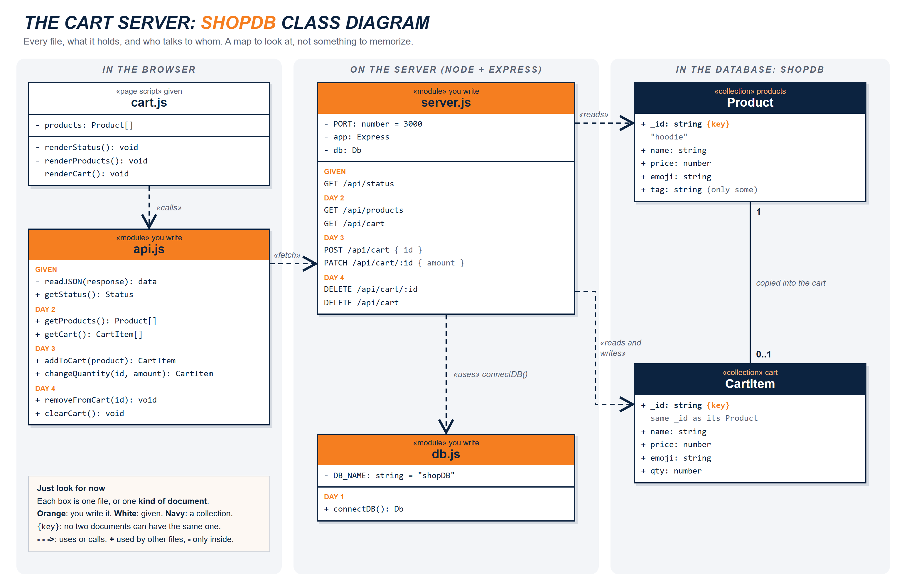

# MongoDB Cart Starter

West-MEC Coding Year 2. Your IndexedDB shopping cart moves to a **server**.

Same shop, same buttons. This time the cart lives in **MongoDB**, and an **Express** server sits between the page and the database. Open the shop in two different browsers: same cart.

You start on a **practice server** that runs on your own computer: no account, nothing to pay for. When your group does the Atlas setup, you switch to **MongoDB Atlas** (the cloud) by pasting one line into `.env`.

## Setup

1. Open the terminal: **PowerShell**, **Git Bash**, or **Command Prompt** (any one works).
2. Move into your code folder on the Desktop (use your folder's real name):

   ```
   cd Desktop
   cd code
   ```

   Desktop not found? It may be inside OneDrive: `cd OneDrive`, then `cd Desktop`.

3. Clone the shop, then move into it:

   ```
   git clone https://github.com/Xerrath/mongodb-cart-starter.git
   cd mongodb-cart-starter
   ```

4. Install the packages (Express, the MongoDB driver, and the practice server):

   ```
   npm install
   ```

5. Is the practice MongoDB already on this computer? (You may have it from Your First Database.)

   ```
   npm run check-mongodb
   ```

   **Only if it says NO**: `npm run get-mongodb` and wait until it says `DONE` (a big download).

6. Make your `.env` file: copy `.env.example` and name the copy `.env`. Leave `MONGODB_URI=` empty for now.
7. Start the shop:

   ```
   npm start
   ```

8. Open **http://localhost:3000** in Chrome. Gray line `connectDB() is not built yet (Day 1)`? That's right: you build it.

Stop the server with **Ctrl+C**. After you change a server file (`db.js`, `server.js`), stop it and `npm start` again. After you change `public/api.js`, just refresh the page.

## The files

| File | What it is | Do you change it? |
| --- | --- | --- |
| `db.js` | Connects the server to MongoDB. | **Yes (Day 1)** |
| `server.js` | The Express server and every `/api` route. | **Yes (Days 2 to 4)** |
| `public/api.js` | Every `fetch` the page makes to the server. | **Yes (Days 2 to 4)** |
| `public/cart.js` | Draws the page and calls `api.js`. | No (read it!) |
| `public/index.html`, `global.css`, `images/` | The shop page. | No |
| `setup/` | Practice server, products, status route, MongoDB download. | No |
| `.env` | Your connection string. **Never on GitHub.** | Only to switch to Atlas |



## See your data

- Any GET route: open it in the browser, like **http://localhost:3000/api/cart**.
- On Atlas: **Data Explorer** (Browse Collections) > `shopDB`.

## Switch to Atlas (after your group's Atlas setup)

1. Open `.env`. Paste your connection string after `MONGODB_URI=` (no spaces, no quotes, with your real password in it).
2. Stop the server (Ctrl+C) and `npm start` again.
3. The terminal and the page say **MongoDB Atlas**. Your cart starts empty: it's a different database.

Back to the practice server: delete everything after `MONGODB_URI=` and restart.

## Stuck?

- **EADDRINUSE or DBPathInUse**: the shop is already running in another terminal. Ctrl+C there.
- **I changed server.js but nothing changed**: stop the server (Ctrl+C) and `npm start` again.
- **Atlas: `querySrv` / timeout errors**: the network may block Atlas. Empty `MONGODB_URI=`, restart, and tell your teacher.
- **Atlas: `bad auth`**: the password in your string is wrong. Check password #2.
- **Start over (practice server)**: stop the server, delete the `.practice-db` folder, `npm start`.

Needs Node.js 20.19 or newer (`node -v` to check).
